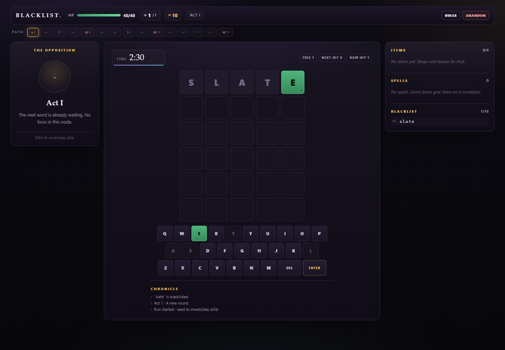

# BLACKLIST

A word roguelike about the words you can never say again.

The first word of every round is added to a 16-word blacklist. You can never guess it again, and the hidden answer is never chosen from that list. Solve the word before the clock or your health runs out. Three acts. Seven bosses. One active save, and defeat wipes it.

**Play:** https://michaelayao88.github.io/blacklist/



---

## What is in the vertical slice

- Wordle-style scoring with duplicate-letter handling
- A 16-word blacklist that records the first guess of each round, with oldest-first eviction
- A shrinking round timer, scaling damage and per-round armor charges
- Three acts, five nodes per act: `round → round → support → round → boss`
- Shops with rerolls, food, spells and permanent upgrades
- Happenings with visible odds and persistent consequences
- Every finished encounter pays gold; solves also offer one of three rewards: gold, a spell, or a permanent attribute
- Bosses award one of three rare relics with passive effects; relics take no slots and never appear in shops
- 45 items (36 shop items + 9 rare boss relics), 8 spells, 4 foods and 7 happenings
- Seven bosses:
  - **The Editor** — hides the last three tiles of each guess
  - **The Sleeper** — wakes after two hits in a guess and hits for 10
  - **The Censor** — draws from the hardest 420 answers; hides the first tile
  - **The Auditor** — shows counts only, never positions
  - **Vowel Fog** — vowels are ambiguous green-or-yellow
  - **Monochrome** — every present letter is ambiguous, never positioned
  - **The Gauntlet** — three puzzles, one shared 150-second clock, no per-guess damage
- One exact-state autosave slot. Defeat clears it. Victory clears it and updates meta stats.
- Combat HUD with player and enemy art, damage popups and a low-time warning
- Pause (Space or Esc), mute, synthesized SFX, keyboard and on-screen keyboard, colorblind symbols, reduced-motion-friendly CSS

Not in this version: ascension, daily seeds, meta unlocks beyond win/run counters, dordle grids, Antiwordle, liar clues, Green Warden. The state and seed plumbing is already there for those.

---

## Run rules

| Thing | Value |
|---|---|
| Starting HP | 40 |
| Starting armor | 1 charge |
| Starting item slots | 4 |
| Free guesses per round | 2 |
| Starting gold | 10 |
| Blacklist capacity | 16 |
| Normal timer | `max(45s, 150s − 6s × roundsSeen − 10s × ascension) + timeBonus` |
| Boss timer | none, except The Gauntlet |
| Base damage | `1 + act` |
| Paid guess damage | `base + paidGuessesThisRound` |
| Timeout damage | `ceil(maxHp × 0.35) + 5`, bypasses armor, ends the round |
| Armor | one charge absorbs one whole damage event; refills each round |
| Solve gold | `6 + 2 × roundsSeen`, plus item effects |
| Timeout gold | `3 + act`; a death pays nothing |
| Shop reroll | starts at 2 gold, +1 per reroll |

The answer pool excludes the blacklist, already-used answers and purged letters.

---

## Development

```bash
npm install
npm run dev        # Vite dev server
npm test           # core + headless UI tests
npm run build      # typecheck + production build
npm run preview    # preview the production build
```

The site deploys automatically from `main` through `.github/workflows/pages.yml`.

---

## Architecture

The core is a pure reducer:

```ts
step(state, command) → { state, events }
view(state) → RunView
```

- `src/core/` has no DOM, browser, content or framework imports.
- Time only arrives through `tick` commands.
- Randomness only comes from the seeded RNG stored in `RunState`.
- State is plain JSON. No `Date.now`, `Math.random`, `structuredClone`, `Set`/`Map` in serialized state.
- The UI replays events and renders absolute post-change views.
- Boss presentation masks are applied inside the core, so a client cannot accidentally reveal the truth.

```
src/
  core/        portable engine, types, RNG, scoring, host adapter
  content/     items, spells, bosses, upgrades, foods, happenings
  data/        generated word lists
  ui/          vanilla DOM client
  game.ts      core instance wired to content
```

### Reusing the core

The web client is one adapter around `CoreHost`:

```ts
import { createCore } from './core/engine';
import { CONTENT } from './content';

const core = createCore(CONTENT);
const result = core.newRun({ seed: 'daily-2026-01-01' });
const view = core.view(result.state);
```

For React, keep the same core and replace `src/ui/`. For Unity, run the compiled JS through a JS runtime, or port the reducer using `src/core/types.ts`, `src/content/` and the command/event contract as the specification. There are no rule rewrites required.

`src/core/host.ts` provides an injectable `SaveStore`; the web app uses `localStorage`, tests use `MemoryStore`.

The purity test in `tests/engine.test.ts` fails if any file under `src/core/` touches browser globals or ambient randomness.

---

## Word data

- Answer and allowed-guess lists: [cfreshman's Wordle lists](https://gist.github.com/cfreshman/a03ef2cba789d8cf00c08f767e0fad7b) (answers) and [allowed guesses](https://gist.github.com/cfreshman/cdcdf777450c5b5301e439061d29694c).
- Profanity and slur filtering is applied when generating `src/data/answers.json` and `src/data/valid.json`.
- `src/data/hard.json` is generated by `scripts/build-hard.mjs` using a deterministic letter-frequency/duplicate-letter heuristic. It is a difficulty ranking, not a full solver.
- The Phone a Friend list is original joke vocabulary, not game data.

Run `node scripts/build-hard.mjs` after changing the answer list.

---

## License

Code: MIT. Word lists retain the terms of their sources above.
