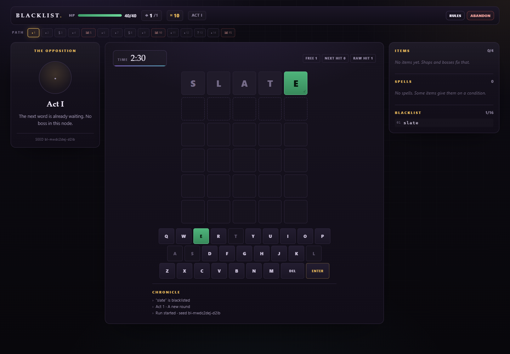

# BLACKLIST

A word roguelike about the words you can never say again.

The first word of every round is added to the blacklist. It has no limit, nothing is ever evicted, and you can never guess those words again. The hidden answer is never chosen from that list. Solve the word before the clock or your health runs out. Five acts. Eight bosses. Ascension levels after your first win. One active save, and defeat wipes it.

**Play:** https://michaelayao88.github.io/blacklist/



---

## What is in the vertical slice

- Wordle-style scoring with duplicate-letter handling
- An unlimited blacklist that records the first guess of each round; no word is ever evicted
- A shrinking round timer, fixed encounter damage and a per-round armor pool
- One free guess per round; correct guesses never deal damage, and wrong paid guesses take the monster's fixed hit
- Five acts, six nodes per act: `round → support → round → support → round → boss` (30 encounters)
- Shops with rerolls that double in price: three items, two foods and one wildcard (spell/food/item); one item is always 50% off
- Five item slots by default. Only equipped gear is active, and each shop has a drag-and-drop loadout
- **Loose Tongue**, a rare relic that lets you guess five-letter nonsense for free-form probes
- Spells stack by type and come from food, item triggers and the shop wildcard slot
- **Restore** clears the blacklist and refills armor; **Contrapuntal** turns into a random relic if you cast all seven spell types
- Happenings with visible odds and persistent consequences
- Short item, spell and offer text with hover tooltips for keywords like armor, reveal, ruled out, free guesses, blacklist, relic and timeout
- Revealed letters stay marked on the keyboard and in a Revealed panel for the puzzle; random reveals lean toward letters that are not in the answer; letter-reveal foods are permanent for the run
- Every finished encounter pays gold; solves offer coins, usually a spell, and only rarely gear or a meal
- **Compound Interest** pays 10% of current gold on every solve; **Midas Touch** has a 20% chance to double any gold gain; **Speed Dial** casts Phone a Friend at the start of every round
- Opening shields such as **Head Start** and **Quickdraw** make guesses in their window count as free guesses, so they deal no damage and do not advance the Ascension damage ramp
- Boss encounters open with a full-screen intro, a plain-language rules list and a continue gate
- Bosses award one of three rare relics with passive effects; relics consume an item slot and never appear in shops
- Defeat reveals the answer you missed (all of them, on The Gauntlet)
- 101 items (83 shop items + 18 rare relics), 7 spells, 19 foods and 12 happenings
- Purge is an event (The Redaction), not a spell
- Eight bosses:
  - **The Editor** — hides the last three tiles of each guess
  - **The Sleeper** — asleep until three hits land, then every wrong guess deals 10
  - **The Censor** — draws from the hardest 420 answers; hides the first tile
  - **The Auditor** — shows counts only, never positions
  - **Vowel Fog** — vowels are ambiguous silver tiles, never green or yellow
  - **Monochrome** — every present letter is an ambiguous silver tile, never positioned
  - **The Horde** — each wrong guess adds a body that covers one more tile from the right
  - **The Gauntlet** — three puzzles, one shared 150-second clock, no per-guess damage
- Ascension 1–9 unlock one level at a time after a victory; modifiers stack and are chosen on the title screen
- One exact-state autosave slot. Defeat clears it. Victory clears it and updates meta stats.
- Compact battle rail on the left: round timer with a hover tooltip for timeout damage, a wrong-guess damage chip, a side-view mini arena with the runner facing the act's monster (or boss), player HP and armor
- Damage numbers slam into the centre of the screen as `N damage`, with a block message when armor or immunity eats the hit
- Spells and the blacklist sit on the right, with items below them
- Pause (Space or Esc), independent music/SFX mutes, synthesized SFX, keyboard and on-screen keyboard, colorblind symbols, reduced-motion-friendly CSS
- Automatic soundtrack: runs open on Dark Synthwave, each new act picks a random track, and boss encounters switch to More Power. The top-bar **MUSIC** control mutes it separately from game sounds; music sits below the SFX mix

Not in this version: daily seeds, meta unlocks beyond win/run counters and ascension, dordle grids, Antiwordle, liar clues, Green Warden. The state and seed plumbing is already there for those.

---

## Music

Music is automatic. The title screen and the first act open on **Dark Synthwave**; every new act picks a random regular track; boss encounters switch to **More Power**, then the area track returns. The **MUSIC** control on the title screen and top bar mutes music separately from game sounds.

**Liborio Conti** — free to use, no attribution required, via [no-copyright-music.com](https://www.no-copyright-music.com/):

- More Power
- Chip Tunes (Chiptune)
- Dark Score
- Drums (Upbeat Drums)
- Dangerous

**Sub_Clair** — via [Pixabay](https://pixabay.com/users/sub_clair-55456531/) under the Pixabay Content License:

- Dark
- Dark Synthwave

---

## Run rules

| Thing | Value |
|---|---|
| Starting HP | 40 |
| Starting armor | 5 points |
| Starting item slots | 5 (only equipped gear counts; relics use one slot each) |
| Free guesses per round | 1, plus every guess made inside a timed shield |
| Starting gold | 10 |
| Blacklist capacity | unlimited; entries are never removed |
| Normal timer | `max(45s, 150s − 6s × roundsSeen) + timeBonus` |
| Boss timer | none, except The Gauntlet |
| Base damage | `2 + 2 × act + roundSlot + ⌊roundsSeen / 3⌋` (roundSlot is 0, 1 or 2 within the act) |
| Paid guess damage | the encounter's fixed hit, plus the Ascension damage ramp; it does not climb on its own |
| Boss damage | fixed per boss (`5–10`), scaled by the active Ascension bonus |
| Timeout damage | `2 × guess hit + ceil(maxHp × 0.3)`, bypasses armor, ends the round |
| Armor | a pool that soaks damage point-for-point before HP; refills each round |
| Solve gold | `5 + solveGoldBonus` (Midas Touch can double any gain) |
| Timeout gold | `1`; a death pays nothing |
| Solve reward | a flat 5 gold plus a spell (65%) or food (35%); gear is an 8% find |
| Boss reward | one of three rare relics |
| Shop reroll | starts at 2 gold (before Ascension), doubles after each use |

### Ascension

Ascension is unlocked after a victory. Each level is cumulative:

| Level | Modifier |
|---|---|
| 1 | Wrong non-free guesses add +1 damage to later wrong guesses |
| 2 | Rounds start 20s shorter; start with 1 armor instead of 5 |
| 3 | −10 max HP, shop prices +10%, boss damage +10% |
| 4 | Rounds start 20s shorter |
| 5 | Wrong non-free guesses add +1 more damage (ramp +2) |
| 6 | −10 max HP, shop prices +10%, boss damage +10% |
| 7 | Rounds start 20s shorter |
| 8 | −10 max HP, shop prices +10%, boss damage +10% |
| 9 | Shop prices +10% |

So A9 starts with 10 max HP, 1 armor, rounds 60s shorter, shop prices +40%, boss damage +30% and a +2 damage ramp per wrong non-free guess. Beating level N unlocks N+1, up to A9.

The answer pool excludes the blacklist, already-used answers and purged letters.

---

## Development

```bash
npm install
npm run dev        # Vite dev server
npm test           # core + headless UI tests
npm run build      # typecheck + production build
npm run preview    # preview the production build
```

The site deploys automatically from `main` through `.github/workflows/pages.yml`.

---

## Architecture

The core is a pure reducer:

```ts
step(state, command) → { state, events }
view(state) → RunView
```

- `src/core/` has no DOM, browser, content or framework imports.
- Time only arrives through `tick` commands.
- Randomness only comes from the seeded RNG stored in `RunState`.
- State is plain JSON. No `Date.now`, `Math.random`, `structuredClone`, `Set`/`Map` in serialized state.
- The UI replays events and renders absolute post-change views.
- Boss presentation masks are applied inside the core, so a client cannot accidentally reveal the truth.

```
src/
  core/        portable engine, types, RNG, scoring, host adapter
  content/     items, spells, bosses, foods, happenings
  data/        generated word lists
  ui/          vanilla DOM client
  game.ts      core instance wired to content
```

### Reusing the core

The web client is one adapter around `CoreHost`:

```ts
import { createCore } from './core/engine';
import { CONTENT } from './content';

const core = createCore(CONTENT);
const result = core.newRun({ seed: 'daily-2026-01-01' });
const view = core.view(result.state);
```

For React, keep the same core and replace `src/ui/`. For Unity, run the compiled JS through a JS runtime, or port the reducer using `src/core/types.ts`, `src/content/` and the command/event contract as the specification. There are no rule rewrites required.

`src/core/host.ts` provides an injectable `SaveStore`; the web app uses `localStorage`, tests use `MemoryStore`.

The purity test in `tests/engine.test.ts` fails if any file under `src/core/` touches browser globals or ambient randomness.

---

## Word data

- Answer and allowed-guess lists: [cfreshman's Wordle lists](https://gist.github.com/cfreshman/a03ef2cba789d8cf00c08f767e0fad7b) (answers) and [allowed guesses](https://gist.github.com/cfreshman/cdcdf777450c5b5301e439061d29694c).
- Profanity and slur filtering is applied when generating `src/data/answers.json` and `src/data/valid.json`.
- `src/data/hard.json` is generated by `scripts/build-hard.mjs` using a deterministic letter-frequency/duplicate-letter heuristic. It is a difficulty ranking, not a full solver.
- The Phone a Friend list is original joke vocabulary, not game data.

Run `node scripts/build-hard.mjs` after changing the answer list.

---

## License

Code: MIT. Word lists retain the terms of their sources above.
